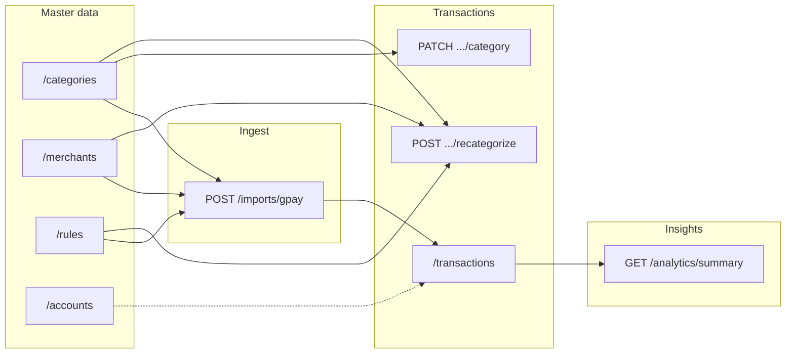
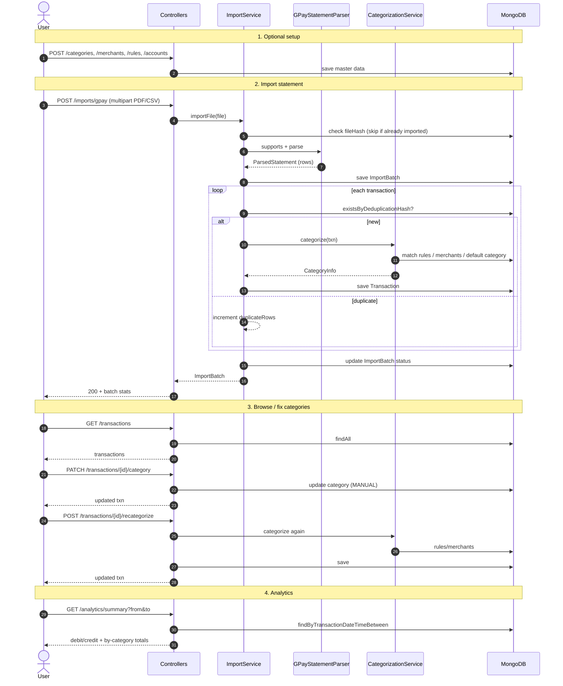

# Finance Tracker Backend

Feature-based Spring Boot modular monolith for importing Google Pay **CSV and PDF** statements, categorizing and deduplicating transactions, and serving transaction and analytics APIs.

## Stack

| Piece | Detail |
|-------|--------|
| Language | Java 20 |
| Build | Gradle (Spring Boot 3.5.x) |
| API | Spring Web + SpringDoc OpenAPI |
| Persistence | Spring Data MongoDB |
| Import parsers | Apache Commons CSV, Apache PDFBox |
| Ops | Spring Boot Actuator (`/actuator/health`) |

There is no Docker setup in this project. MongoDB is expected to be available via the configured URI (local or Atlas).

## Prerequisites

- Java 20 (`JAVA_HOME` pointing at a JDK 20 install)
- A reachable MongoDB instance (local `27017` or Atlas)

## Configuration

Primary config lives in `src/main/resources/application.properties`.

| Property | Default / notes |
|----------|-----------------|
| `spring.data.mongodb.uri` | MongoDB connection string |
| `spring.data.mongodb.database` | `expense_tracker` |
| `server.port` | `8080` (`PORT` env override) |
| `app.timezone` | `Asia/Kolkata` (`APP_TIMEZONE`) |
| `app.currency` | `INR` (`APP_CURRENCY`) |
| Multipart limits | 15 MB max file / request |

## Build and run

```bash
export JAVA_HOME=/path/to/jdk-20
./gradlew clean build
./gradlew test
./gradlew bootRun
```

- API base: `http://localhost:8080`
- Swagger UI: `/swagger-ui.html`
- Health: `/actuator/health`

## Project layout

```
src/main/java/com/example/finance/
├── FinanceApplication.java
├── account/           # bank account CRUD
├── analytics/         # spend summary
├── categorization/    # rules + CategorizationService
├── category/          # categories (+ seed on startup)
├── common/            # config, exception handling
├── importstatement/   # GPay import (CSV/PDF), ImportBatch
├── merchant/          # merchant CRUD
└── transaction/       # transactions + recategorize/override
```

## MongoDB collections

Database: **`expense_tracker`**

| Collection | Document |
|------------|----------|
| `transaction_records` | Imported / managed transactions |
| `import_batches` | Per-file import stats, hash, errors |
| `categories` | Category taxonomy (seeded on boot) |
| `merchants` | Merchant → default category |
| `categorization_rules` | Pattern / keyword rules |
| `accounts` | Bank accounts (provider, last4, etc.) |

## Import: GPay CSV & PDF

`POST /api/v1/imports/gpay` accepts multipart field **`file`**.

- **CSV** — common date, time, amount, counterparty, and UPI headers; original columns kept in `originalData`
- **PDF** — Google Pay transaction statement layout (PDFBox text extract + regex); supports statements like `gpay_statement_YYYYMMDD_YYYYMMDD.pdf`
- Deduplication by file hash (same file returns existing batch; failed batches can be retried) and per-transaction `deduplicationHash`
- Auto-categorization via rules → merchants → default category
- Batch response includes `totalRows`, `parsedRows`, `importedRows`, `duplicateRows`, `failedRows`, `errors`, and statement period

Example:

```bash
curl -X POST "http://localhost:8080/api/v1/imports/gpay" \
  -F "file=@gpay_statement_20260301_20260831.pdf;type=application/pdf"
```

## REST API catalog

| Area | Method | Endpoint | Purpose |
|------|--------|----------|---------|
| **Import** | `POST` | `/api/v1/imports/gpay` | Upload GPay CSV/PDF → parse → categorize → save |
| **Transactions** | `GET` | `/api/v1/transactions` | List all |
| | `GET` | `/api/v1/transactions/{id}` | Get one |
| | `PATCH` | `/api/v1/transactions/{id}/category` | Manual override — body `{"categoryId":"..."}` |
| | `POST` | `/api/v1/transactions/{id}/recategorize` | Re-run rules / merchant matching |
| | `POST` | `/api/v1/transactions/recategorize` | Recategorize uncategorized/default transactions in bulk |
| | `POST` | `/api/v1/transactions/ai-recategorize` | AI-categorize eligible transactions in a bounded batch |
| **Categories** | `GET` / `POST` | `/api/v1/categories` | List / create |
| | `PUT` / `DELETE` | `/api/v1/categories/{id}` | Update / delete |
| **Merchants** | `GET` / `POST` | `/api/v1/merchants` | List / create |
| | `PUT` | `/api/v1/merchants/{id}` | Update |
| **Rules** | `GET` / `POST` | `/api/v1/rules` | List / create categorization rules |
| | `PUT` / `DELETE` | `/api/v1/rules/{id}` | Update / delete |
| **Accounts** | `GET` / `POST` | `/api/v1/accounts` | List / create |
| | `PUT` | `/api/v1/accounts/{id}` | Update |
| **Analytics** | `GET` | `/api/v1/analytics/summary?from=&to=` | Debit/credit + by-category totals |
| | `GET` | `/api/v1/analytics/monthly?year=` | Monthly gross amount, debit, and credit totals for a calendar year |

### How APIs connect



- **Categories / Merchants / Rules** feed auto-categorization during import and recategorize.
- **Import** writes `import_batches` + `transaction_records`.
- **Transactions** read/update those records.
- **Analytics** aggregates transactions by date range and category.
- **Accounts** are managed separately; bank name / last4 on each txn link conceptually.

### End-to-end sequence



Typical happy path: seed categories/rules → upload GPay PDF/CSV → list transactions → optionally override or recategorize → pull analytics summary.

### AI recategorization

AI recategorization is opt-in. Configure `APP_AI_CATEGORIZATION_ENABLED=true`, `APP_AI_CATEGORIZATION_API_KEY`, and optionally `APP_AI_CATEGORIZATION_PROVIDER`, `APP_AI_CATEGORIZATION_MODEL`, and `APP_AI_CATEGORIZATION_BASE_URL`. The default `openai-compatible` strategy uses an OpenAI-compatible Chat Completions API. Configure `APP_AI_CATEGORIZATION_PROVIDER` as `openai`, `openrouter`, or `xai` alongside that provider's base URL, key, and model when its selected model supports the request format. Do not commit provider keys. A provider that uses a different API protocol can be added as another strategy without changing the batch categorization rules or endpoint contract.

For example, to use a compatible endpoint, set `APP_AI_CATEGORIZATION_PROVIDER=openrouter` and configure its base URL, API key, and model in the backend environment.

```bash
curl -X POST "http://localhost:8080/api/v1/transactions/ai-recategorize" \
  -H "Content-Type: application/json" \
  -d '{"limit":100,"minimumConfidence":0.7,"dryRun":true,"onlyDefaultCategory":true}'
```

The request body is optional. Defaults are `limit=100`, `minimumConfidence=0.7`, `dryRun=false`, and `onlyDefaultCategory=true`. The configured maximum batch size defaults to 100. The batch scans transactions but only considers non-manual records, and by default further limits candidates to those currently assigned by the fallback category. Set `onlyDefaultCategory` to `false` to include rule/merchant categories too. `dryRun=true` returns proposals without saving. Responses include per-transaction `UPDATED`, `PROPOSED`, `LOW_CONFIDENCE`, or `FAILED` statuses and totals. Accepted suggestions are saved with categorization source `AI`; manual overrides are never changed.

The service sends transaction type, amount, currency, description, counterparty name, active category names/descriptions, and temporary references to the configured provider. It does not send database IDs, UPI IDs, account fields, or raw imported columns. Keep in mind descriptions and counterparty names can still contain personal information.

Each provider API call writes a log entry with provider, model, outcome, and prompt/completion/total token usage when the response includes usage metadata. If a provider omits usage or the request fails before a response is received, token counts are logged as unavailable. These counts are reported by the provider and do not estimate tokens locally.

## Sample analytics call

```bash
curl "http://localhost:8080/api/v1/analytics/summary?from=2026-03-01&to=2026-08-31"
```

Monthly totals for a calendar year (all 12 months are returned, including months with no transactions):

```bash
curl "http://localhost:8080/api/v1/analytics/monthly?year=2026"
```
